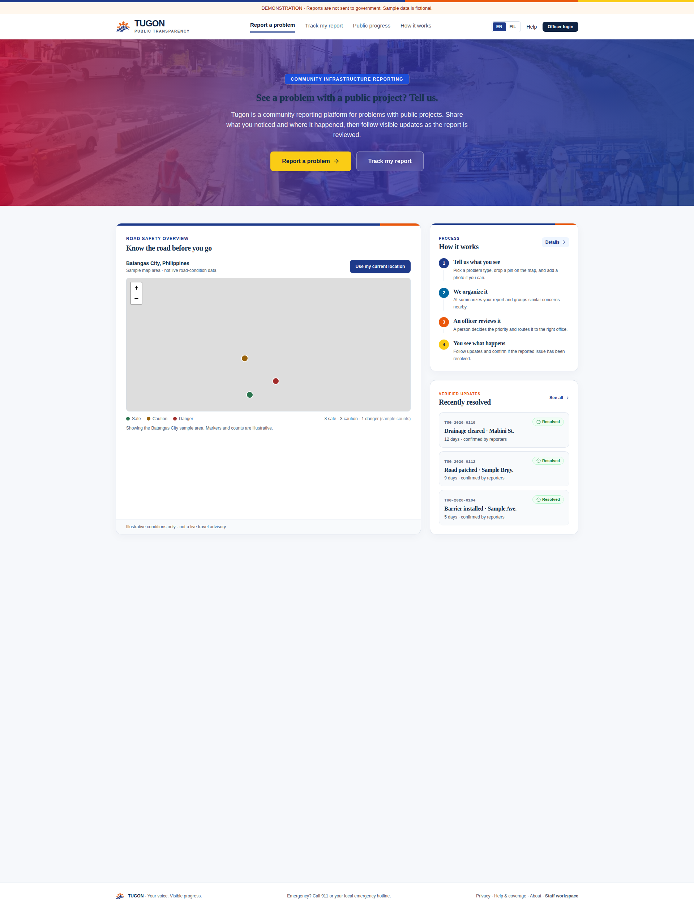
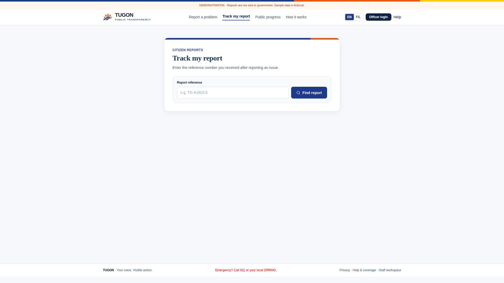
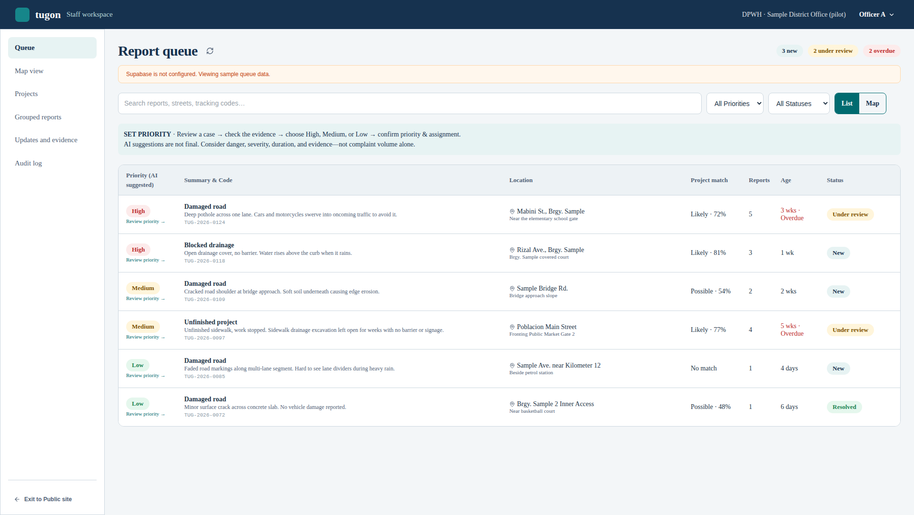

# Tugon — Your voice. Visible progress.

A community reporting platform for problems with public projects. Citizens can report issues like damaged roads, blocked drainage, unsafe construction, and unfinished projects — then follow visible updates as reports are reviewed.

> **Demonstration only.** Reports are not sent to government. Sample data is fictional.

## Features

- **Report a problem** — A guided 3-step flow to submit an issue with location, photos, and description
- **Road safety map** — Interactive Leaflet map centered on Batangas City with sample hazard markers and geolocation support
- **Track my report** — Look up report status by reference number
- **Public progress** — View and filter sample community reports by status
- **How it works** — Step-by-step guide with FAQ section
- **Bilingual (EN/FIL)** — Toggle between English and Filipino, persisted in localStorage

## Product views

### 1. Home



### 2. Track your report



### 3. Public reports


### 4. Admin



## Team

| Member | Role |
|---|---|
| Charles | Team Leader |
| Ryan | UI/UX Designer |
| Bryan | Backend Developer |
| Yohan | AI/Data Analyst |

## Tech Stack

| Layer | Technology |
|---|---|
| Framework | React 19 |
| Language | TypeScript 5.7 |
| Build | Vite |
| Styling | Tailwind CSS 4 |
| Maps | Leaflet + React Leaflet |
| Routing | React Router 7 |
| Icons | Lucide React |

## Getting Started

### Prerequisites

- Node.js 18+
- npm

### Installation

```bash
git clone https://github.com/AyeNyeinSan22/Tugon.git
cd Tugon
npm install
```

### Development

```bash
npm run dev
```

Opens at `http://localhost:5173`.

### Build

```bash
npm run build
```

### Preview production build

```bash
npm run preview
```

## Project Structure

```
Tugon/
├── index.html
├── package.json
├── vite.config.ts
├── tsconfig.json
├── public/
│   └── tugon-mark.svg
└── src/
    ├── main.tsx              # Entry point
    ├── App.tsx               # Routing & page components
    ├── LanguageProvider.tsx   # EN/FIL i18n context
    ├── ReportFlow.tsx        # Multi-step report submission
    ├── RoadSafetyMap.tsx     # Interactive Leaflet map
    ├── FaqSection.tsx        # Accordion FAQ
    └── index.css             # Global styles & Tailwind
```

## Pages

| Route | Description |
|---|---|
| `/` | Home page with hero, map, categories, how-it-works, FAQ |
| `/report` | 3-step report flow (Problem → Location → Details) |
| `/track` | Report lookup by reference number |
| `/progress` | Filterable public progress list |
| `/how-it-works` | Detailed guide + FAQ |

## Categories

- **Damaged road** — Potholes, cracks, sinking surface
- **Blocked drainage** — Clogged canals, flooding spots
- **Unfinished project** — Work stopped or abandoned
- **Unsafe construction** — Open pits, no barriers or signs
- **Broken walkway or bridge** — Hard or unsafe to cross
- **Something else** — Tell us in your own words

## License

MIT
