# Tugon — Your voice. Visible progress.

A community reporting platform for problems with public projects. Citizens can report issues like damaged roads, blocked drainage, unsafe construction, and unfinished projects — then follow visible updates as reports are reviewed.

> **Demonstration only.** Reports are not sent to government. Sample data is fictional.

## Features

- **Report a problem** — A guided 3-step flow to submit an issue with location, photos, and description
- **Road safety map** — Interactive Leaflet map centered on Batangas City with sample hazard markers and geolocation support
- **Track my report** — Look up report status by reference number
- **Public progress** — View and filter sample community reports by status
- **How it works** — Step-by-step guide with FAQ section
- **Bilingual (EN/FIL)** — Toggle between English and Filipino, persisted in localStorage

## Product views

### 1. Home

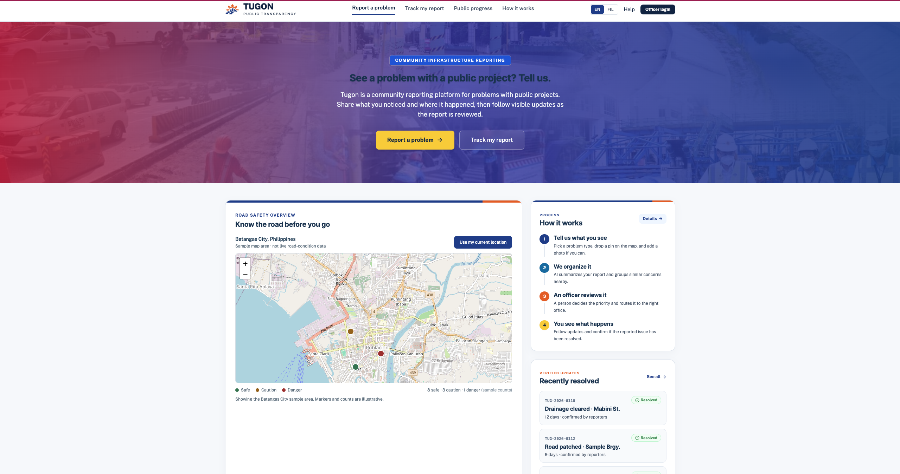

### 2. Step-by-step report process

The guided reporting flow takes citizens from picking a problem type to receiving a tracking ID.

#### Step 1 — Choose a problem type
Pick the closest match (damaged road, blocked drainage, unsafe construction, and more).

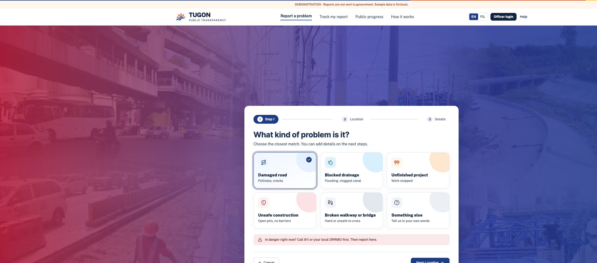

#### Step 2 — Add the location
Drop a map pin or enter a street and nearby landmark so the issue can be found.

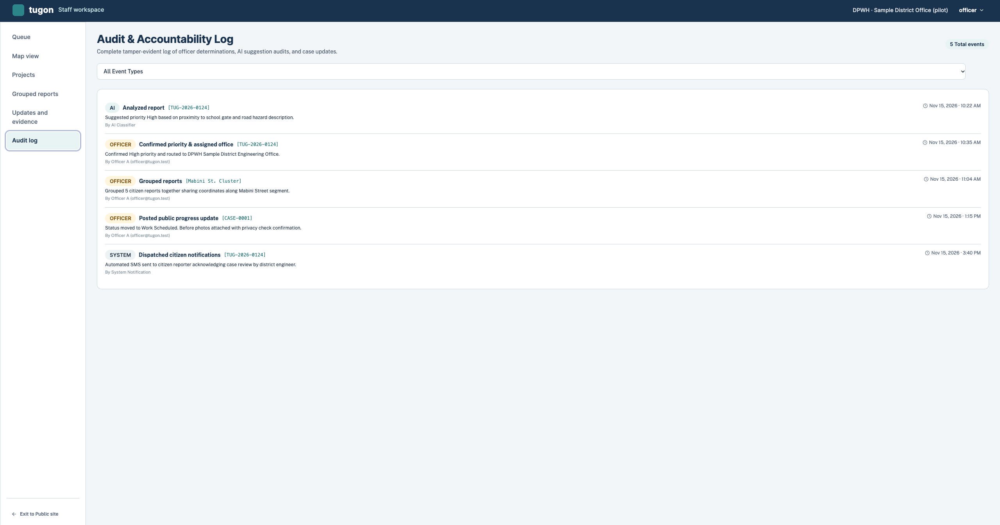

#### Step 3 — Tell us more (details)
Add photos, describe what you noticed, and when you first saw it.

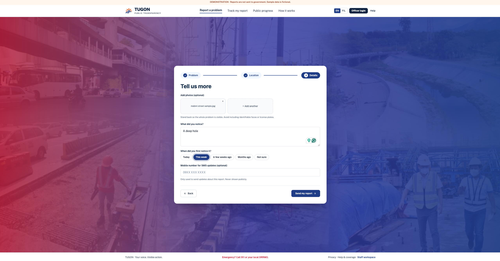

#### AI summary — Review your report
An AI-generated draft summarizes the report before submission. Government staff make every decision — the citizen can edit or confirm.

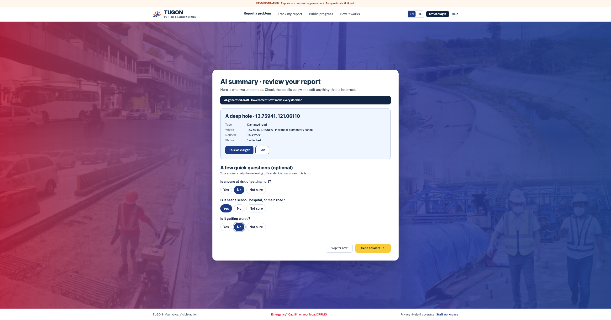

#### Confirmation — Tracking ID
A tracking ID is issued so citizens can follow their report.

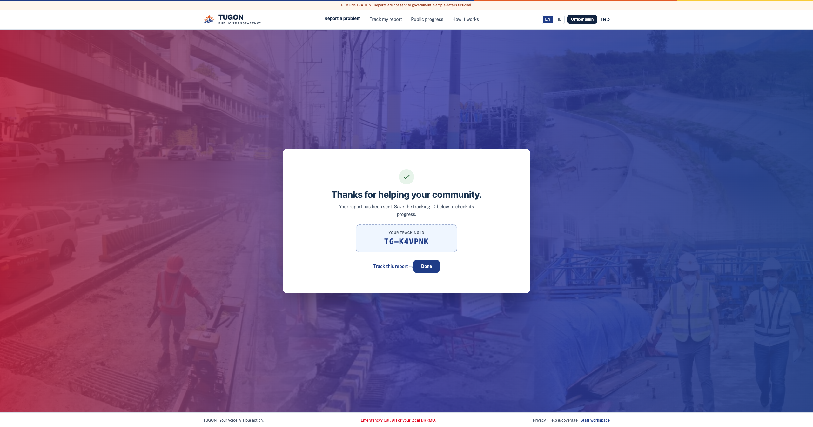

### 3. Track your report process

Enter the reference number you received after reporting, then follow the review timeline.

#### Search by reference
Look up a report using its tracking ID (e.g. `TG-99EZQN`).

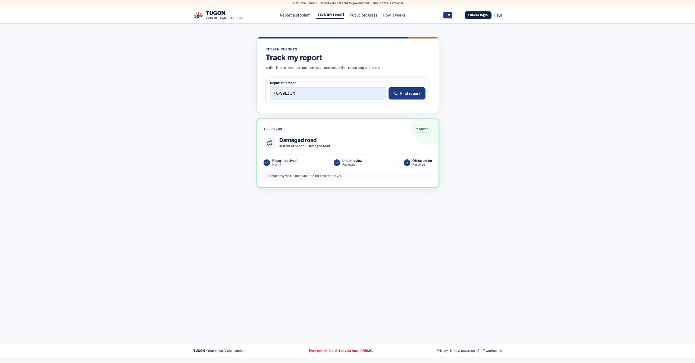

#### Review timeline
See the report's progress — Report received → Under review → Office action — with its current status.


### 4. Public reports

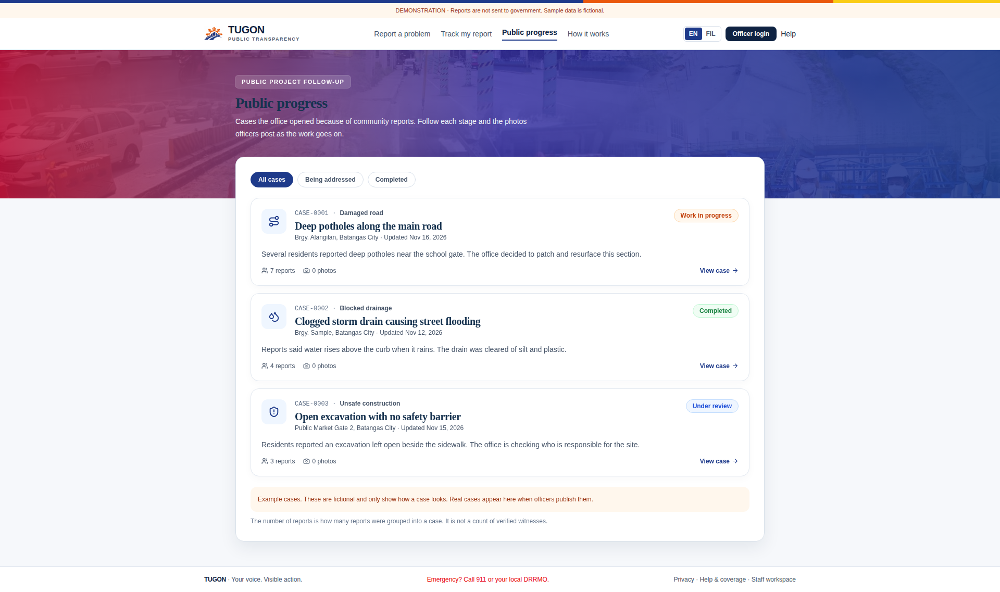

### 5. Admin


## Feature walkthrough

### Citizen — Public site

#### Home
Landing page with hero, road safety overview map, process steps, and recently resolved cases.


#### Track my report
Look up a report by reference number and see the review timeline.


#### How it works
A 4-step explainer (choose → locate → describe → review) with FAQ.

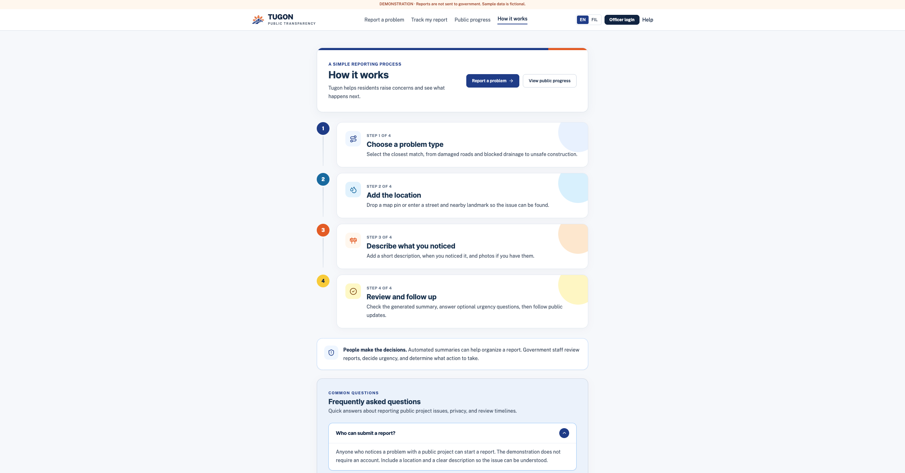

### Staff workspace

#### Report queue
Prioritized queue with AI-suggested priority, project match, age, and status filters.

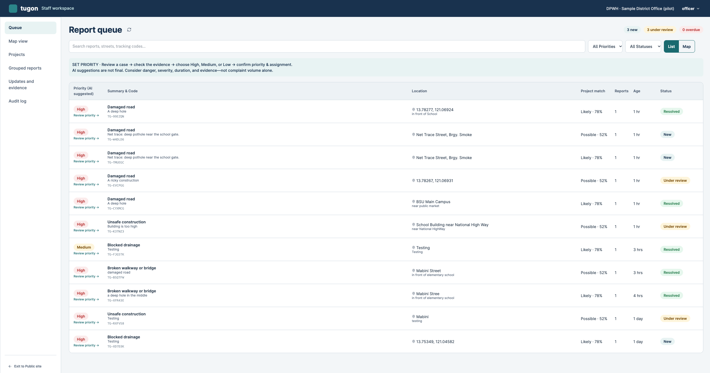

#### Government projects & contracts
Registry of active/planned projects used for automated report matching and verification.

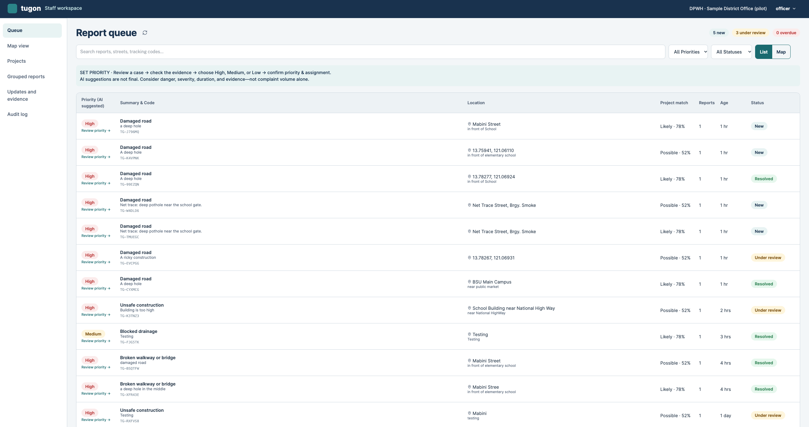

#### Grouped reports & public cases
Group citizen reports into verified public cases, record progress, and publish to the citizen portal.

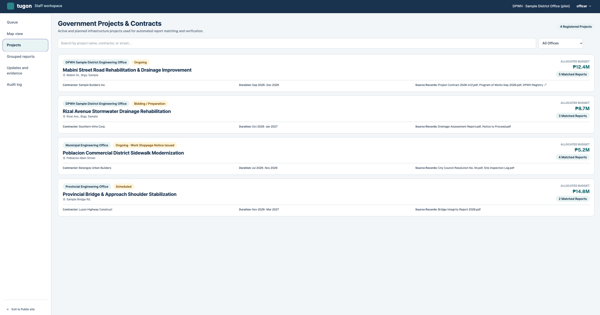

#### Post a public update
Set new status, write a plain-language citizen message, attach before/after evidence, and publish.

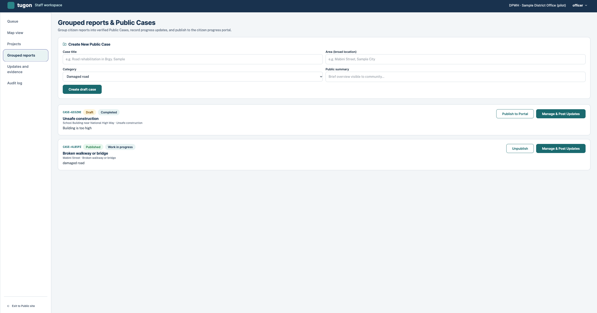

#### Audit & accountability log
Tamper-evident log of officer determinations, AI suggestion audits, and case updates.

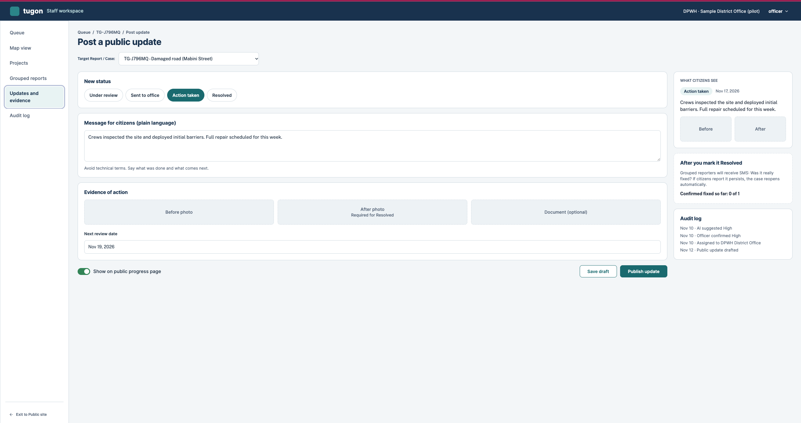

#### Report queue (alternate view)
Another view of the prioritized queue with different filters applied.


## Team

| Member | Role |
|---|---|
| Charles | Team Leader |
| Ryan | UI/UX Designer |
| Bryan | Backend Developer |
| Yohan | AI/Data Analyst |
| San | Frontend Developer |

🌐 [weareteamtugon.vercel.app](https://weareteamtugon.vercel.app/)

## Tech Stack

| Layer | Technology |
|---|---|
| Framework | React 19 |
| Language | TypeScript 5.7 |
| Build | Vite |
| Styling | Tailwind CSS 4 |
| Maps | Leaflet + React Leaflet |
| Routing | React Router 7 |
| Icons | Lucide React |

## Getting Started

### Prerequisites

- Node.js 18+
- npm

### Installation

```bash
git clone https://github.com/AyeNyeinSan22/Tugon.git
cd Tugon
npm install
```

### Development

```bash
npm run dev
```

Opens at `http://localhost:5173`.

### Build

```bash
npm run build
```

### Preview production build

```bash
npm run preview
```

## Project Structure

```
Tugon/
├── index.html
├── package.json
├── vite.config.ts
├── tsconfig.json
├── public/
│   └── tugon-mark.svg
└── src/
    ├── main.tsx              # Entry point
    ├── App.tsx               # Routing & page components
    ├── LanguageProvider.tsx   # EN/FIL i18n context
    ├── ReportFlow.tsx        # Multi-step report submission
    ├── RoadSafetyMap.tsx     # Interactive Leaflet map
    ├── FaqSection.tsx        # Accordion FAQ
    └── index.css             # Global styles & Tailwind
```

## Pages

| Route | Description |
|---|---|
| `/` | Home page with hero, map, categories, how-it-works, FAQ |
| `/report` | 3-step report flow (Problem → Location → Details) |
| `/track` | Report lookup by reference number |
| `/progress` | Filterable public progress list |
| `/how-it-works` | Detailed guide + FAQ |

## Categories

- **Damaged road** — Potholes, cracks, sinking surface
- **Blocked drainage** — Clogged canals, flooding spots
- **Unfinished project** — Work stopped or abandoned
- **Unsafe construction** — Open pits, no barriers or signs
- **Broken walkway or bridge** — Hard or unsafe to cross
- **Something else** — Tell us in your own words

## License

MIT
